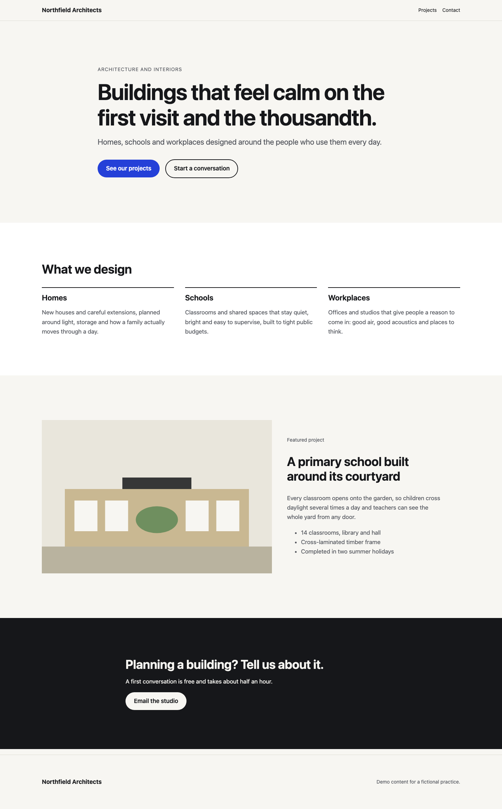
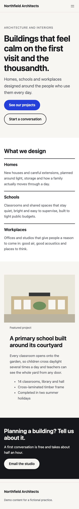

# WordPress block theme sample

A small, complete block theme that shows how [Kodinav](https://kodinav.com/for-studios) builds a design studio's design in WordPress. The content is a fictional architecture practice; the code, structure and checks are the same ones client work goes through.

| Desktop | Phone |
| --- | --- |
|  |  |

## What's in it

```
theme.json        Colors, type scale, spacing and layout widths: the design tokens from the Figma file
templates/        Page templates (front page, page, post, archive, 404)
parts/            Header and footer, editable in the Site Editor
patterns/         Each section of the design as a pattern the client can insert, reorder and edit
functions.php     Pattern category and a visible focus ring; nothing else
tests/            The page checks below
```

There's no page builder and no required plugin. Clients edit text, images and section order in the normal WordPress editor, and the layout is hard to break: custom colors and font sizes are switched off, so every choice they make stays inside the design system.

## Conventions

- **Tokens first.** Every color, font size and spacing value lives in `theme.json`. Templates and patterns refer to presets (`var:preset|spacing|50`), never to raw values, so a design change happens in one place.
- **Sections are patterns.** A section from the design becomes a pattern in `patterns/`. A custom block is written only when a section needs behavior that core blocks can't give it.
- **Fluid type and spacing.** Sizes scale with the viewport through `clamp()`, so tablet widths look designed rather than squeezed.
- **One H1 per page, headings in order.** The hero pattern carries the page's only H1.
- **Translatable and escaped.** Every string in a pattern goes through `esc_html_e()` / `esc_attr_e()` with the theme's text domain.
- **Prefixed.** Functions and globals start with the theme's prefix, so nothing collides with plugins.

On a studio's project the theme name, author, text domain and prefix are the studio's own. Nothing in a delivered theme mentions Kodinav.

## Checks

Every page goes through the same checks before it's handed over:

| Check | How |
| --- | --- |
| WordPress coding standards | PHPCS with [WPCS](https://github.com/WordPress/WordPress-Coding-Standards) (`phpcs.xml.dist`) |
| WCAG 2.2 AA (automated part) | axe-core at phone and desktop widths |
| No sideways scrolling | 390, 820 and 1440 px |
| One H1, no skipped heading levels | every page |
| Images have alt text; zoom isn't blocked | every page |
| Matches the design | screenshots at the three widths, compared side by side with the Figma frames |

Automated tools cover only part of WCAG, so every page is also tabbed through with a keyboard by hand.

The checks run on every push and pull request (see `.github/workflows/checks.yml`). To run them locally:

```sh
npm install
npx playwright install chromium
npm start          # WordPress with this theme at http://127.0.0.1:9400 (admin / password)
npm test           # in a second terminal; screenshots land in tests/screenshots/

composer install
composer lint      # WordPress coding standards
```

`npm start` uses [WordPress Playground](https://wordpress.org/playground/), so there's nothing else to install: no PHP, database or Docker.

## How work arrives on a real project

Each page or batch comes as a branch and pull request in the studio's repository (or on its staging site), with the screenshots and check results attached. The studio reviews it and merges it; its client sees nothing until the studio approves.

More about working this way: [kodinav.com/for-studios](https://kodinav.com/for-studios) · [Partner terms](https://kodinav.com/white-label-partner-agreement)

## License

GPL-2.0-or-later, like WordPress itself.
